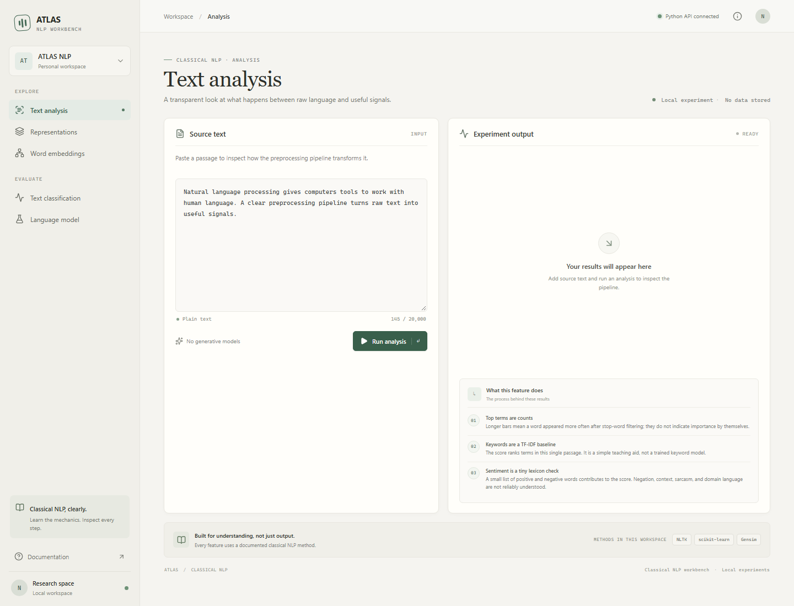
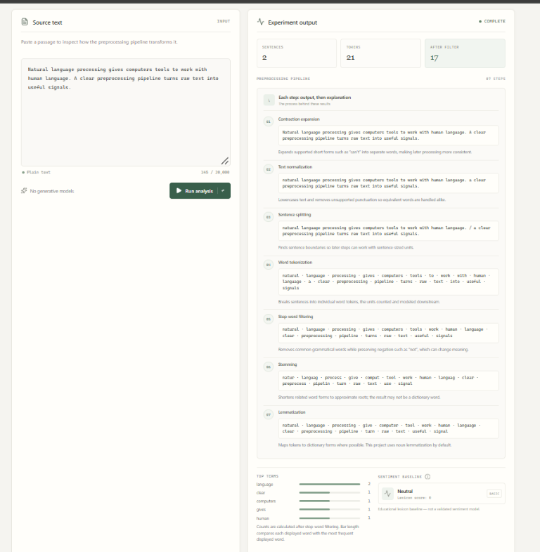
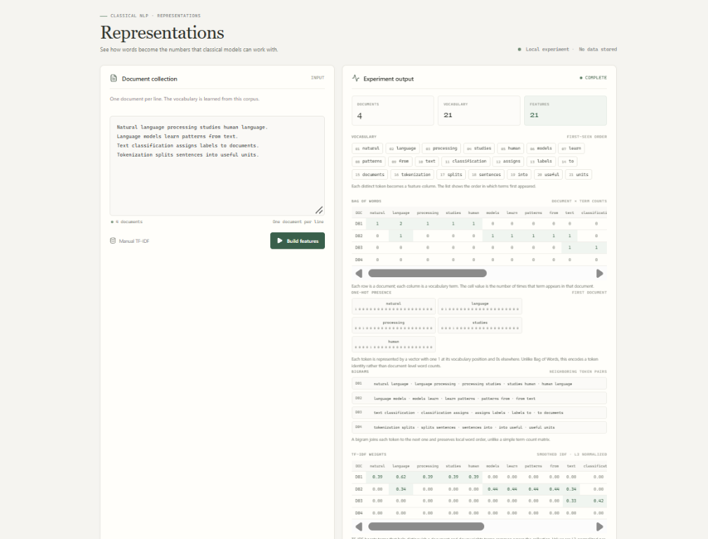
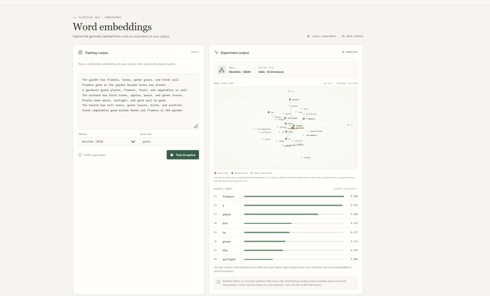
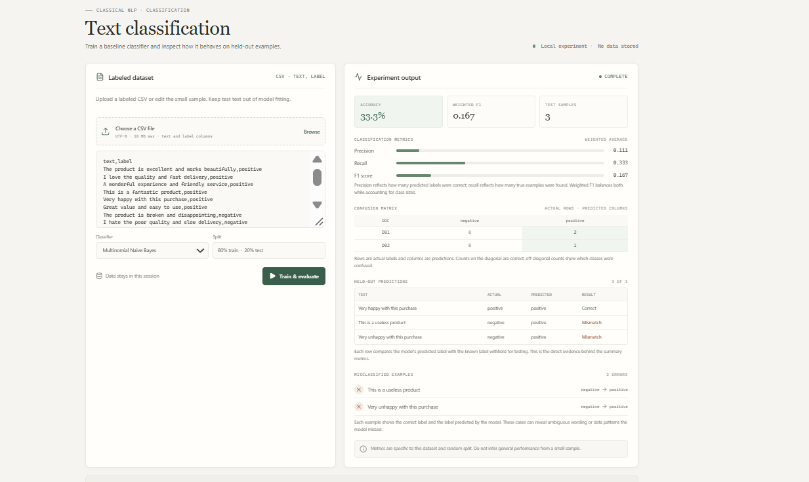
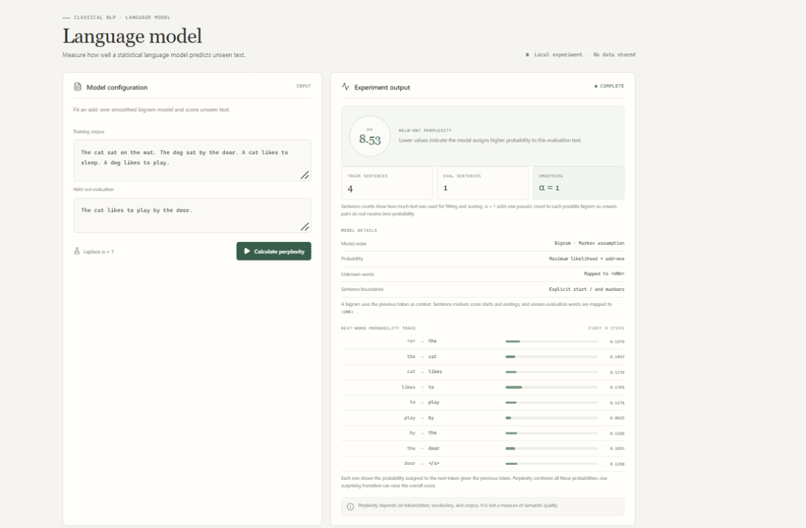

# ATLAS — NLP Workbench

**GitHub description:** An interactive workbench for exploring classical NLP,
from text preprocessing and representations to embeddings, classification,
and language models.

ATLAS is a modular Python project for learning and using classical NLP. It contains
preprocessing, sparse text representations, classical classifiers, statistical
language modeling, static embeddings, text analysis, evaluation, and a Streamlit
interface. It does not use LLMs, generative AI, RAG, or vector databases.

## Problem statement

Classical NLP is often taught as separate algorithms, while the connection
between raw text, preprocessing, numeric features, model predictions, and
evaluation can be hard to see. ATLAS addresses this learning gap with an
interactive workbench that lets users provide text or labeled examples, inspect
intermediate outputs, and see explanations alongside results for each step.

ATLAS is intended for learning and small, reproducible experiments. It is not a
production text-understanding service, and its bundled demonstration examples
do not establish real-world model quality.

## Architecture

Each feature has its own module under
`src/smart_text_intelligence/`. `main.py` composes features and exposes small
workflows; it does not duplicate feature implementations. Matching tests live
under `tests/`.

```text
src/smart_text_intelligence/
├── analysis/          # Frequencies, keywords, similarity, sentiment baseline
├── classification/    # Naive Bayes, Logistic Regression, prediction
├── data/              # CSV loading and reproducible train/test splitting
├── embeddings/        # Word2Vec, FastText, GloVe, vector operations
├── evaluation/        # Metrics, error analysis, representation comparison
├── language_model/    # N-grams, bigrams, smoothing, perplexity
├── preprocessing/     # Cleaning through stemming and lemmatization
├── representation/    # One-hot, BoW, n-grams, manual TF-IDF
└── main.py            # CLI and workflow orchestration
api/
└── app.py              # FastAPI adapter for the React client
app/
└── streamlit_app.py
frontend/
└── src/                # Independent React + TypeScript workbench
tests/
```

## Setup (Windows PowerShell)

Use Python 3.10 or newer:

```powershell
py -3.10 -m venv .venv
.\.venv\Scripts\Activate.ps1
python -m pip install --upgrade pip
python -m pip install -e ".[dev,app]"
python -m nltk.downloader stopwords wordnet omw-1.4
```

The React app requires Node.js 20.19 or newer (or 22.12 or newer).

## React workbench

The React interface is a separate app. It calls the local FastAPI adapter,
which imports the existing Python functions; NLP logic is not duplicated in
JavaScript. The original Streamlit app remains available unchanged.

Install frontend dependencies once:

```powershell
Set-Location frontend
npm ci
Set-Location ..
```

Start each service in its own PowerShell terminal from the repository root.

Terminal 1 — Python API:

```powershell
.\.venv\Scripts\Activate.ps1
python -m uvicorn api.app:app --reload
```

Terminal 2 — React development server:

```powershell
Set-Location frontend
npm run dev
```

Open `http://localhost:5173`. The API health and interactive NLP routes are
available at `http://localhost:8000/api/health` and
`http://localhost:8000/docs`. The Vite development server proxies `/api` to
FastAPI. Requests are processed in memory; no user text or uploaded CSV is
persisted.

The React interface includes text analysis, manual representations, labeled
CSV classification, representation comparison, small-corpus embedding
exploration, and held-out bigram perplexity. Its bundled CSV is a UI
demonstration only—not a real dataset or evidence of model quality. Embeddings
are trained on the user-provided corpus; no pretrained vector files are sent to
or downloaded by the React app.

## Screenshots



The overview shows the text analysis workspace and navigation between the five
features. Each feature is shown below with a description of what it helps
explore.

### Text analysis



Inspect how raw text changes through preprocessing, from contraction expansion
and tokenization to stop-word filtering, stemming, and lemmatization. The
results also show frequent terms, TF-IDF keyword scores, and a small lexicon
sentiment baseline.

### Representations



Explore how a document collection becomes numeric features. The view compares
vocabulary and document counts with bag-of-words, one-hot, bigram, and manual
TF-IDF representations.

### Word embeddings



Train static word embeddings on a small corpus and inspect nearby words by
cosine similarity. The PCA map is a two-dimensional approximation of the full
vector space; similarity results use the original vectors.

### Text classification



Train a baseline classifier on labeled text and review held-out metrics,
confusion counts, predictions, and misclassified examples. Results depend on
the selected dataset and split and should not be treated as general performance
claims.

### Language model



Evaluate a smoothed bigram language model against held-out text. The results
include perplexity and a next-word probability trace to show how the model
scores word sequences.

## Problem statement

Classical NLP is often taught as separate algorithms, while the connection
between raw text, preprocessing, numeric features, model predictions, and
evaluation can be hard to see. ATLAS addresses this learning gap with an
interactive workbench that lets users provide text or labeled examples, inspect
intermediate outputs, and see explanations alongside results for each step.

ATLAS is intended for learning and small, reproducible experiments. It is not a
production text-understanding service, and its bundled demonstration examples
do not establish real-world model quality.

Build the production frontend bundle:

```powershell
Set-Location frontend
npm run build
```

## Run tests and examples

```powershell
python -m pytest
python -m smart_text_intelligence.main
python -m smart_text_intelligence.main preprocess "This isn't a bad example."
python -m smart_text_intelligence.main analyze "The service was not good."
python -m smart_text_intelligence.main represent "cats purr" "dogs bark"
python -m smart_text_intelligence.main language-model "cats purr. dogs bark." "cats bark."
python -m smart_text_intelligence.main embeddings cats "cats purr" "cats sleep" "dogs bark"
python -m smart_text_intelligence.main compare data/raw/messages.csv
```

Start the user interface from the project root:

```powershell
streamlit run app/streamlit_app.py
```

The app offers text analysis, CSV-based classification, representation
comparison, small-corpus embedding exploration, and bigram language-model
evaluation. Uploaded CSV files are limited to 10 MB.

## Supply a labeled dataset

The project intentionally does not bundle a dataset or claim dataset-specific
performance. Choose and document a dataset that you are permitted to use. For
the CLI and app, provide a UTF-8 CSV with non-empty text and label columns:

```csv
text,label
"claim your free prize now",spam
"please send the meeting notes",ham
```

Run a held-out classification evaluation with:

```powershell
python -m smart_text_intelligence.main classify data/raw/messages.csv `
  --text-column text --label-column label --model naive_bayes
```

Compare Bag of Words and TF-IDF (plus averaged Word2Vec unless disabled) on
the same reproducible split with:

```powershell
python -m smart_text_intelligence.main compare data/raw/messages.csv `
  --text-column text --label-column label
```

The default split is 80/20 with a fixed seed and stratification when the class
counts support it. The vectorizer is fit within the training pipeline, so test
text is not used to learn the vocabulary. Record the dataset source, license,
labels, split, seed, and results before presenting metrics as project findings.

## Reproducible benchmark status

A real-dataset benchmark is not bundled yet. Before publishing benchmark
results, select a dataset with a verified license that permits the intended
use, document the source and label mapping, and keep raw data out of the
repository unless its license explicitly permits redistribution. The benchmark
should use one fixed split and seed to compare:

- Bag of Words + Multinomial Naive Bayes
- TF-IDF + Logistic Regression
- Averaged Word2Vec embeddings

Report macro-F1, precision, recall, accuracy, confusion matrices, and runtime
for each method. Describe these as reproducible, dataset-specific baselines,
not universal performance claims.

## Reproducible benchmark status

A real-dataset benchmark is not bundled yet. Before publishing benchmark
results, select a dataset with a verified license that permits the intended
use, document the source and label mapping, and keep raw data out of the
repository unless its license explicitly permits redistribution. The benchmark
should use one fixed split and seed to compare:

- Bag of Words + Multinomial Naive Bayes
- TF-IDF + Logistic Regression
- Averaged Word2Vec embeddings

Report macro-F1, precision, recall, accuracy, confusion matrices, and runtime
for each method. Describe these as reproducible, dataset-specific baselines,
not universal performance claims.

## What is implemented

- **Preprocessing:** configurable cleaning, sentence splitting, Unicode-aware
  tokenization, defined contraction expansion, negation-preserving NLTK
  stop-word removal, Porter stemming, and WordNet lemmatization.
- **Representations:** first-seen vocabulary and one-hot vectors, manual
  document-term counts, contiguous n-grams, and a dense educational TF-IDF
  transformer. Smoothed manual TF-IDF follows scikit-learn's IDF convention;
  unsmoothed IDF is `log(N / df)`.
- **Classification:** scikit-learn Multinomial Naive Bayes and Logistic
  Regression pipelines with BoW or TF-IDF features.
- **Language modeling:** sentence-boundary n-gram counts, MLE/add-alpha bigram
  probabilities, unknown-token handling, and held-out perplexity.
- **Embeddings:** Gensim CBOW/Skip-gram Word2Vec and FastText, a compact
  from-scratch GloVe trainer for small learning corpora, and a loader for
  plain-text GloVe vectors.
- **Analysis and evaluation:** deterministic frequency ranking, single-document
  TF-IDF keyword baseline, embedding similarity, a tiny lexicon sentiment
  baseline, weighted classification metrics, confusion matrix, error examples,
  and a train-only BoW/TF-IDF/averaged-Word2Vec comparison.

## Limitations and interpretation

- Stop-word removal preserves negation by default. The simple sentence splitter
  can split abbreviations incorrectly.
- Contraction expansion only expands a defined set of unambiguous forms;
  ambiguous forms such as `it's` are left untouched.
- WordNet lemmatization defaults to noun POS. Supply the correct POS to improve
  verb/adjective results.
- The sentiment feature is an educational lexicon baseline, not a validated
  sentiment model. Single-document TF-IDF keyword ranking is also a simple
  baseline; meaningful corpus-level keyword comparisons need multiple documents.
- The educational GloVe optimizer is intended for small data, not production.
  Word2Vec/FastText quality depends on the corpus and settings; word vectors are
  static and do not represent context-dependent meanings.
- Averaged Word2Vec comparison scores are illustrative: the tiny dataset used
  for a run, random seed, vocabulary coverage, and training parameters affect
  them. Do not interpret scores as a universal ranking of representations.
- Select and document a suitable licensed dataset before making claims about
  application accuracy or generalization.
